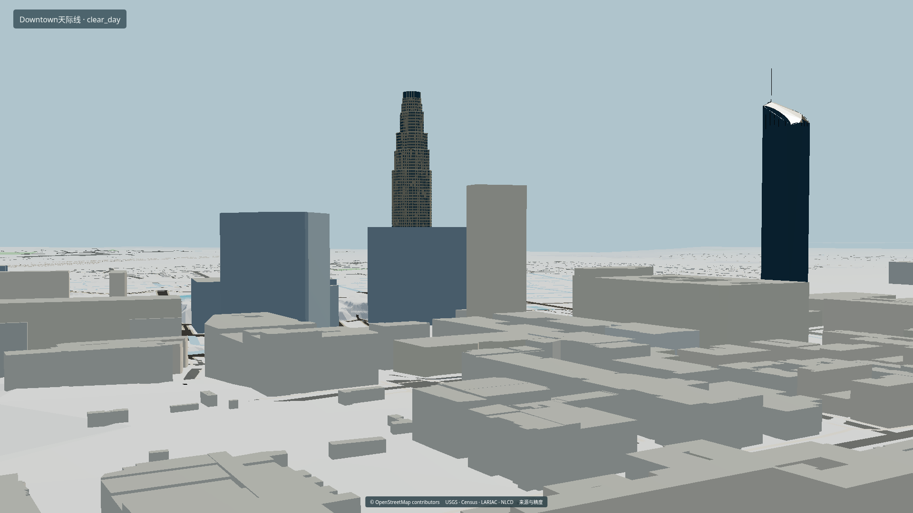
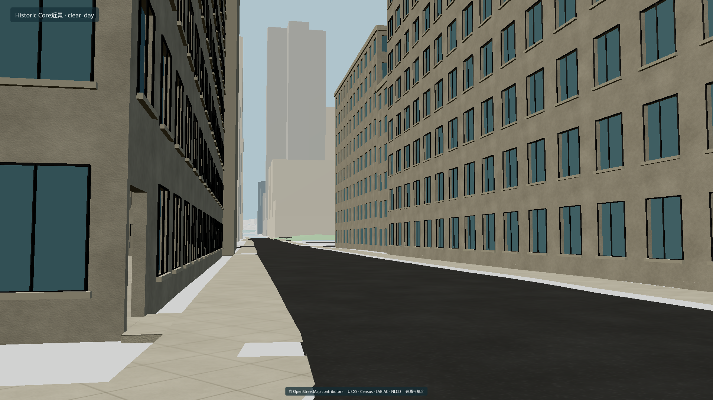

# Los Angeles City Exterior · 1.0.0

基于真实地理资料的洛杉矶Blender城市外景与本地交互查看器。仓库为私有；完整模型上传与校验进行中，发布完成后见[v1.0.0 Release](https://github.com/CloudAis/LA-City-Model/releases/tag/v1.0.0)。整体建模验收为**部分通过**，保留数据年代、推断高度、地标细部及场地接口缺口。





## 下载与打开

- **只浏览模型**：从[模型分支查看器ZIP文件页](https://github.com/CloudAis/LA-City-Model/blob/delivery-v1.0.0/deliveries/v1.0.0/LA_Local_Private_Viewer_1.0.zip)下载原文件。完整解压后运行python start.py --port 8090，同机浏览器打开http://127.0.0.1:8090。需要Python3.10+及WebGL2，运行时不需要Node、Blender或互联网。
- **完整Blender工程**：按[下载与恢复说明](docs/GITHUB.md)取得所有分卷和清单，恢复到outputs/LA_Delivery。Blender4.3.2打开其中LA_Master.blend，保留整个assets目录，特别是assets/linked中的两个关联城市工程。独立地标见landmarks。
- **源码**：默认main分支保持轻量；8919份模型、纹理、查看器构建、52张展示图及视频由Git LFS保存在[delivery-v1.0.0分支](https://github.com/CloudAis/LA-City-Model/tree/delivery-v1.0.0/deliveries/v1.0.0)，Release提供下载入口。模型分支克隆需要Git LFS及私有仓库访问权限。

完整交付恢复后可直接启动：

```bash
cd outputs/LA_Delivery
python start.py --port 8090
```

展示图地址为http://127.0.0.1:8090/previews/index.html，十地标索引在/previews/landmarks/index.html，24秒720p视频在/video/city_tour.mp4。48张实际WebGL图和四张CPU渲染均为1920×1080。云环境localhost与用户电脑localhost分别指向各自运行服务的机器。

## 范围、质量与验收

行政分块域约1299.693km²，Downtown工作窗16km²。最细为HistoricCore与CivicCenter两个350×400m工作窗，合计0.28km²；100栋细化足迹并集约0.1530km²，其中5栋有重点外观研究。工作窗面积不等于全部完成精修；十地标均为资料支持的近似。SantaMonica、BeverlyHills未启用背景。

- [十阶段最终验收表](docs/final/FINAL_ACCEPTANCE.md)
- [实测性能](docs/final/PERFORMANCE.md)
- [工程维护、样本修改与扩展](docs/final/DELIVERY.md)
- [坐标、单位、数据年代和估算](docs/final/COORDINATES_AND_DATA.md)
- [许可、来源与准确依赖](docs/final/LICENSES_AND_DEPENDENCIES.md)

本次4核/32GiB、SwiftShader软件WebGL2，中档1920×1080窗口/960×540内部渲染，三轮巡游平均20.73FPS；HistoricCore约9.67FPS，原生1080p街景约3.78FPS。按用户允许调整后的巡游平均15FPS目标通过，初始原生1080p30FPS未通过；硬件GPU/显存未知。高档保留PBR映射，但为软件设备关闭阴影与透射；原生物理材质保留。预览来自实际模型，不将可运行城市称为完整照片写实或测绘复原。

## 重建与维护

开始工作先读[PROJECT_SPEC.md](PROJECT_SPEC.md)和[STATUS.md](STATUS.md)。旧阶段完整流水线依赖原始数据及历史清单；本仓库发布最终交付和源码，约9GB原始采集资料、全量历史缓存及阶段01–09历史工程仍保留原云工作区。最终交付包含已实际测试的两栋建筑样本输入，恢复后可按维护说明改配置并重建样本。

原云工作区已有数据时，统一入口为：

```bash
./project env
./project check --stage 10 --region city --quality medium
./project run --stage 10 --region city --quality medium
./project export --stage 10 --region city --quality medium
```

最终交付目录可以独立使用Python3.12执行python scripts/check_delivery.py核对全部文件。第十阶段流水线只支持city/medium，其他组合明确返回未实现；查看器内部三档另行切换。输入或冻结成果改变时停止并保留用户编辑。完整联网冷重建、所有设备及全部地面接口未认证。

私有保存不代表第三方数据已取得公开再分发授权；原创代码、软件依赖和地理资料的许可分别保留。未添加覆盖全项目的统一许可证。原始数据、阶段01–09成果和公开CloudAis/Base远端均保留原状。
